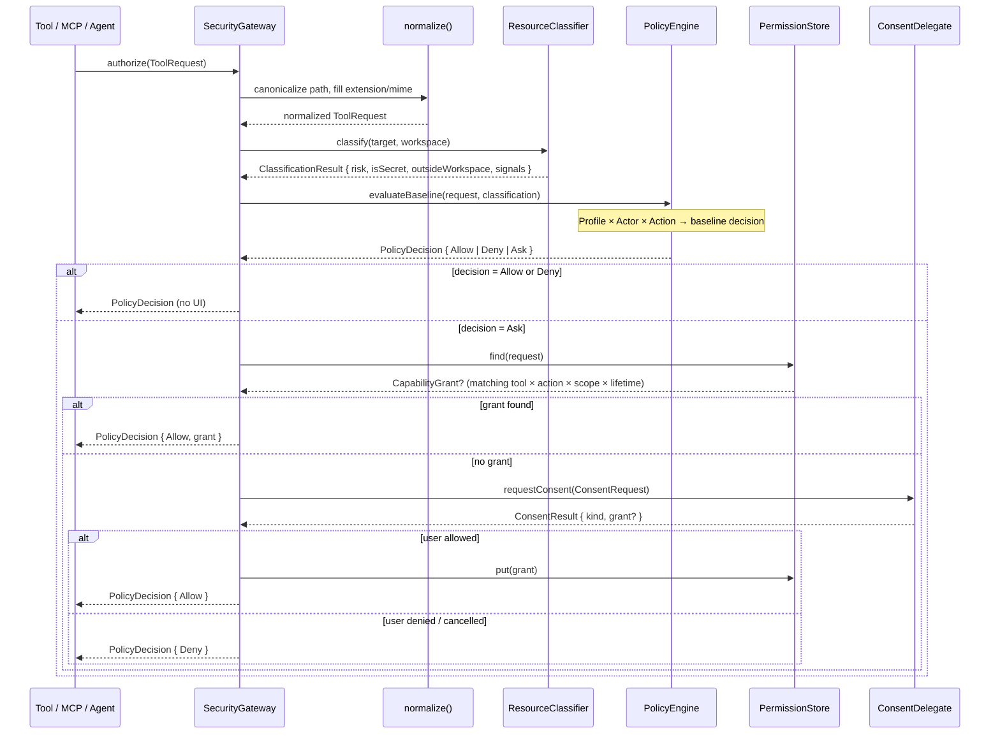
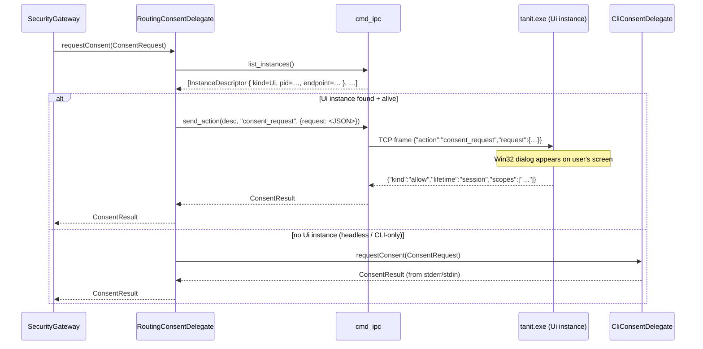

# Security Gateway — Implementation Reference

> Design intent: docs/security/design.md  
> Task list: docs/security/todos.md  
> Test CLI: `src/security/cli.cpp` → `dist/win-x64/pm-image-security.exe`

---

## Core rule

```
LLM proposes.  Gateway decides.  Scoped capability executes.
```

The LLM, MCP servers, plugins, and tool descriptions are untrusted input. Every
tool call must pass through `SecurityGateway::authorize()` before anything
executes.

---

## Module map

```
src/security/
  types.hpp                   ← All enums + structs (single source of truth)
  security_default.hpp        ← Feature-macro defaults, profile compile-time select

  SecurityGateway.hpp/.cpp    ← Choke point: authorize() / executeIfAllowed()
  PolicyEngine.hpp/.cpp       ← Compiled baseline rules per profile
  PermissionStore.hpp/.cpp    ← In-memory grant store (validated put / find)
  ResourceClassifier.hpp/.cpp ← Risk classification (secret patterns, OS dirs)
  PathSecurity.hpp/.cpp       ← Canonicalize + glob match (** / * / ?)
  UriScope.hpp/.cpp           ← URI/path scope matching (file:// https:// ftp://)
  ToolIdentity.hpp/.cpp       ← Tool hash + identity key + wildcard match
  Origin.hpp/.cpp             ← Which binary is driving (provenance registry)
  ConsentDelegate.hpp         ← Abstract UI seam (ConsentRequest → ConsentResult)
  AuditLog.hpp/.cpp           ← Audit sink (stub → later structured log)
  CryptoStore.hpp/.cpp        ← Crypto interface (aes-gcm blob enc/dec)

  SecurityPersistence.hpp/.cpp ← JSON (de)serialization + two persistence backends

  ui/win/ConsentDlg.hpp/.cpp  ← Win32 consent dialog (Win32ConsentDelegate)

  backends/
    SandboxBackend.hpp        ← Abstract interface: spawn / grantPath / revokePath
    win/
      WinDpapiCrypto.cpp      ← DPAPI-backed key + libsodium blob encrypt
      WinAcl.cpp              ← (stub, Phase 3)
      WinPaths.cpp            ← Windows-specific path helpers
      SandboxAppContainer.hpp ← AppContainer backend declaration  (→ next phase)
      SandboxAppContainer.cpp ← AppContainer backend implementation (→ next phase)

  cli.cpp                     ← pm-image-security.exe (test + development CLI)
```

**External dependencies** (in `src/security/` only):

| Dep | Used by |
|---|---|
| `<nlohmann/json>` | `SecurityPersistence`, `cli.cpp` |
| `<CLI/CLI.hpp>` | `cli.cpp` |
| `media::settings` (settings_store) | `SecurityPersistence` backend A |
| libsodium | `WinDpapiCrypto` |
| Windows DPAPI (`CryptProtectData`) | `WinDpapiCrypto` |

---

## Core types (`types.hpp`)

```
Profile      Light | Strict | Developer     (compile-time select, overridable per request)
Actor        User | LLM | Plugin | McpServer | BackgroundAgent
Action       Read | Write | Delete | Execute | Network | Upload | Download | GitPush | Publish
Risk         Low | Medium | High | Critical
DecisionKind Allow | Deny | Ask | Sandbox | AllowRedacted
GrantLifetime Once | Session | Task | UntilTimestamp | Permanent

ResourceTarget  { uri, path, mime, extension }
ToolIdentity    { toolId, provider, serverId, executableHash, manifestHash, signedManifest }
ToolRequest     { actor, profile, origin, tool, action, target?, workspaceRoot, sessionId, taskId, intent }
CapabilityGrant { id, tool, action, resourceScopes[], lifetime, expiresAt, sessionId, taskId, constraints }
ConsentRequest  { title, risk, request, userGoal, whyNeeded, possibleRisk, resourcePreview }
ConsentResult   { kind, grant?, openSettings }
PolicyDecision  { kind, risk, reason, grant?, consent? }
```

### Grant safety invariants (enforced in `PermissionStore::put`)

| Rule | Enforcement |
|---|---|
| `resourceScopes` must be non-empty | `put()` returns false → no ambient authority |
| `never_persistable` actions blocked | `Execute, Delete, GitPush, Publish, Upload` |
| `never_permanent` actions blocked | `Write, Network, Download, + above` → max Session |
| `Once` lifetime blocked | One-shot grants are not persisted |

---

## Authorization flow



---

## Grant matching (`PermissionStore::find`)

A grant matches a request when **all** of the following hold:

```
tool.provider   glob-matches  request.tool.provider   (empty grant field = any)
tool.toolId     glob-matches  request.tool.toolId
tool.serverId   glob-matches  request.tool.serverId
action          ==            request.action
sessionId       ==            request.sessionId       (empty = unbound = any)
taskId          ==            request.taskId
resourceScopes  any-matches   request.target
not expired
```

Scope matching (`UriScope::scope_matches_any`):

```
scope pattern                  example match
──────────────────────────────────────────────────────
C:/work/project/**             C:/work/project/src/foo.ts
file://C:/work/**              file://C:/work/report.csv
https://api.example.com/**     https://api.example.com/v2/query
mcp://github/**                mcp://github/issue/create
${workspace}/**                (expanded at grant creation time)
```

Path normalization uses `fs::canonical` (real path, resolves symlinks) then
`to_slashes` + lowercase before glob comparison — so drive-letter casing and
backslash vs forward-slash differences are collapsed.

---

## Consent delegate chain

```
ConsentDelegate (abstract, ConsentDelegate.hpp)
  │
  ├── DenyAllConsentDelegate       ← safe default (headless, service)
  │
  ├── CliConsentDelegate           ← stdio prompts via --interactive flag
  │     Reads from stdin, writes structured prompt to stderr.
  │     Lifetime choices: once / session / task / permanent (risk-gated).
  │
  ├── Win32ConsentDelegate         ← modal Win32 dialog via --interactive --gui
  │     src/security/ui/win/ConsentDlg.cpp
  │     2×2 grid of lifetime buttons (Once / Session / Task / Always)
  │     "Always" is hidden for never_permanent actions (Write, Network, ...).
  │     "Open settings" opens Explorer/file via ShellExecuteW.
  │
  ├── IpcConsentDelegate           ← forwards consent over cmd_ipc to a live instance
  │     [ next — Phase 1.9 ] src/security/ui/IpcConsentDelegate.hpp/.cpp
  │     Looks up a named instance (by pid or kind), sends action="consent_request",
  │     waits for the reply JSON, deserialises into ConsentResult.
  │     On timeout / transport failure → falls back to CliConsentDelegate.
  │
  ├── AiConsentDelegate            ← LLM-backed autonomous approval (async)
  │     [ future — Phase 1.10 ] src/security/AiConsentDelegate.hpp/.cpp
  │     Uses a named chat preset (local llama or remote) to review the
  │     ConsentRequest and return a ConsentResult without human input.
  │     Async: wraps a std::future, retry + exponential backoff, hard timeout.
  │     On timeout / model unavailable → falls through to next delegate (not deny).
  │     Lifetime ceiling enforced in the delegate itself (configurable per-preset):
  │       - Low risk   → may grant up to Task lifetime
  │       - Medium/High → Once only (or deny, configurable)
  │       - never_persistable / never_permanent rules still enforced by PermissionStore
  │     Audit log marks AI-approved grants: approvedBy = "ai:<preset-name>".
  │
  └── RoutingConsentDelegate       ← discovers the best surface at runtime
        [ next — Phase 1.9 ] src/security/RoutingConsentDelegate.hpp/.cpp
        Priority order (first available wins):
          1. AiConsentDelegate     → autonomous, low-latency (when configured + low risk)
          2. ProcessKind::Ui       → IpcConsentDelegate → Win32 dialog in running app
          3. ProcessKind::Web      → IpcConsentDelegate → browser/WebView surface (future)
          4. stdio                 → CliConsentDelegate (always available as final fallback)
        Each tier has a configurable risk ceiling — e.g. AI handles Low/Medium,
        human UI handles High/Critical. Tiers above their ceiling are skipped.
        Discovery: cmd_ipc::list_instances() filtered by kind + ping alive.

  [ future ] WebConsentDelegate    ← WebView2 / browser consent surface
```

---

## "AI auto" — delegating consent authority to the AI

Each consent surface (Win32, web, CLI) offers an **"AI auto"** option alongside
the standard Once / Session / Task / Always choices. Selecting it does not grant
access directly — it records a *routing preference* that tells the gateway to
consult `AiConsentDelegate` for future matching requests instead of surfacing a
UI prompt.

```
Normal grant     tool × action × scope × lifetime  →  Allow (unconditional)
AI-delegated     tool × action × scope × lifetime  →  Ask AI (each time, silently)
```

The AI can still deny a future request even inside a delegated scope. This is
strictly weaker than a permanent human grant — it trades human interruption for AI
review, not for blanket access.

### Model change — `CapabilityGrant::aiDelegated`

A single boolean flag on `CapabilityGrant`:

```cpp
bool aiDelegated = false;   // when true: route through AiConsentDelegate, not Allow
```

`PermissionStore::find()` returns the grant as usual.  
`SecurityGateway` checks `grant.aiDelegated` before returning `Allow`:

```
if (grant && grant.aiDelegated):
    route to AiConsentDelegate(original_request)
    if AI → Allow:  emit Allow + ai-approved audit entry
    if AI → Deny:   escalate to human tier (configurable: deny or ask)
else if (grant):
    emit Allow directly (existing behaviour)
```

### `ConsentResult` — new `aiDelegated` flag

```cpp
struct ConsentResult {
    DecisionKind kind = DecisionKind::Deny;
    std::optional<CapabilityGrant> grant;   // carries aiDelegated=true when AI auto chosen
    bool openSettings = false;
};
```

The UI surfaces set `grant.aiDelegated = true` and choose a lifetime (Once /
Session / Always) just like a normal allow. The gateway persists this grant; on
the next matching request `find()` returns it and the gateway routes to AI.

### UI changes across all surfaces

**Win32 dialog** (`ConsentDlg.cpp`):  
Replace the 2×2 grid (Once / Session / Task / Always) with a 2×3 grid:

```
[ Allow once  ]   [ Allow session ]   [ Allow always ]
[ AI auto: once ] [ AI auto: session ] [ AI auto: always ]
```

"AI auto" buttons are hidden when `AiConsentDelegate` is not configured
(`ConsentUiOptions::aiAutoAvailable = false`). For `never_permanent` actions,
"AI auto: always" is also hidden (same rule as "Allow always").

**CLI** (`CliConsentDelegate`):  
New response tokens:

```
ai_auto_once      → aiDelegated grant, lifetime=Once
ai_auto_session   → aiDelegated grant, lifetime=Session
ai_auto_always    → aiDelegated grant, lifetime=Permanent (risk-gated, same as allow_always)
```

Or as JSON: `{"choice":"ai_auto","lifetime":"session","scopes":["…"]}`.

**Web UI** (future):  
Same structure as Win32 — the `consent_request` IPC payload includes
`"aiAutoAvailable": true/false` so the web surface knows whether to render the
AI auto tier.

### AI advisory mode — AI enriches, human approves

A lighter alternative to "AI auto": the AI runs *before* the human surface opens,
enriches the `ConsentRequest` with plain-language context and a suggested
lifetime/scope, then the human surface renders the pre-filled suggestion. Human
has final authority — they can accept the suggestion with one click or override
any field.

```mermaid
sequenceDiagram
    participant GW as SecurityGateway
    participant RD as RoutingConsentDelegate
    participant AI as AiConsentDelegate (advisory)
    participant UI as Human surface (Win32 / Web / CLI)

    GW->>RD: requestConsent(ConsentRequest)
    RD->>AI: advise(ConsentRequest)
    Note over AI: LLM analyses tool/action/risk/intent
    AI-->>RD: AiSuggestion { explanation, riskSummary,\n  suggestedLifetime, suggestedScopes }
    RD->>RD: embed AiSuggestion into ConsentRequest
    RD->>UI: requestConsent(enriched ConsentRequest)
    Note over UI: Dialog pre-fills scope + lifetime\nfrom suggestion; shows AI explanation
    UI-->>RD: ConsentResult (human decision)
    RD-->>GW: ConsentResult
```

**`AiSuggestion`** — embedded in `ConsentRequest` before the human surface:

```cpp
struct AiSuggestion {
    std::string explanation;       // plain-language "why this tool needs this"
    std::string riskSummary;       // "this will overwrite the file; consider..."
    GrantLifetime suggestedLifetime = GrantLifetime::Once;
    std::vector<std::string> suggestedScopes;   // narrowed from request target
    std::string presetName;        // which model produced this
};

// Added to ConsentRequest:
std::optional<AiSuggestion> aiSuggestion;
```

**UI rendering of the suggestion:**

- **Win32:** scope editor pre-filled with `suggestedScopes`; suggested lifetime
  button highlighted (not auto-clicked); AI explanation shown in an italic label
  below the resource preview; a small "AI suggested" badge on the highlighted button.
- **CLI:** consent prompt on stderr shows `[AI suggests: session, C:/work/**]`
  before listing the choices; user can accept by typing the matching token or
  override freely.
- **Web/IPC:** `consent_request` payload carries `"aiSuggestion": {…}` when
  advisory mode ran; the web surface renders it as a pre-filled form with an
  "Accept suggestion" shortcut button.

Advisory mode is opt-in per run (`--ai-consent-preset <name>`). When the preset
is not configured, `ConsentRequest.aiSuggestion` is absent and all surfaces
render as today.

### Audit trail

AI-delegated decisions are logged with two entries:

```
1. GRANT_AI_DELEGATED  — when the user selects "AI auto" (human decision recorded)
2. AI_APPROVED / AI_DENIED — on each subsequent AI evaluation of the delegated scope
```

Both carry `approvedBy = "ai:<preset-name>"` in the grant and audit record.

---

## Routing consent — how it works

When the LLM agent CLI runs with `--secure`, it creates a `RoutingConsentDelegate`
rather than a bare `CliConsentDelegate`. On every `Ask` decision, the router:



### IPC wire format for consent

New action verb `consent_request` on the `InstanceServer`, registered on the UI
side alongside `ping` / `status` / `app_cmds`:

```jsonc
// CLI agent → UI process  (send_action payload)
{
  "action": "consent_request",
  "token": "<instance-token>",
  "id": "req-abc123",
  "request": {
    "title": "Allow file write?",
    "risk": "high",
    "tool": { "toolId": "write_file", "provider": "builtin" },
    "action": "write",
    "target": { "path": "C:/work/report.csv" },
    "intent": "Save the exported sales report",
    "whyNeeded": "…",
    "possibleRisk": "…",
    "allowedLifetimes": ["once", "session", "task"]
  }
}

// UI process → CLI agent  (reply)
{
  "type": "consent_reply",
  "id": "req-abc123",
  "kind": "allow",
  "lifetime": "session",
  "scopes": ["C:/work/**"]
}
```

`allowedLifetimes` is computed from `is_never_permanent(action)` and
`is_never_persistable(action)` on the C++ side — so the UI never embeds policy
rules, it only renders what the gateway says is available.

The existing per-instance token challenge (`cmd_ipc`'s shared-secret handshake)
covers the transport — only processes with access to the descriptor file (same
Windows user, OS-ACL'd profile dir) can send `consent_request`.

---

## Persistence backends (`SecurityPersistence.hpp/.cpp`)

Two interchangeable backends, selected at runtime via `--storage`:

### Backend A — `settings-store` (default)

```
settings.json["permissions"]  ← JSON array of CapabilityGrant objects
settings.json["security"]     ← active profile
```

- Encrypted with libsodium (`secretbox`) using a DPAPI-protected per-machine key.
- Key lives at `{config_dir}/settings.key` (DPAPI blob).
- Used when the gateway is embedded inside `tanit.exe` / `tanit-cli.exe`.
- Human-unreadable by design — protects grants from external tampering.

### Backend B — `grants.json` (portable)

```
{config_dir}/grants.json  ← plain UTF-8 JSON array, pretty-printed
```

- No encryption. Human-readable, git-committable, diffable.
- Used by the standalone security CLI, external tools, and tests.
- Same JSON format as the `settings-store` array — schemas are compatible.

### `grant import` — shipping grants from a file

```
pm-image-security.exe --storage grants.json grant import --file pm-grants.json
pm-image-security.exe --storage settings-store grant import --file pm-grants.json --replace
```

Merges (or replaces) a plain JSON grant file into the active store. Each
candidate is validated against the same `put()` rules before being accepted.
Rejected grants are reported in `rejectedGrants[]` but do not abort the import.

**Idempotency:** supply explicit `"id"` fields in shipped templates so re-running
the importer upserts by key rather than inserting duplicates.

**Grant template format** (the shipping file):

```json
[
  {
    "id": "shipped-read-001",
    "tool": { "toolId": "file.read", "provider": "builtin", "serverId": "" },
    "action": "read",
    "resourceScopes": ["C:/work/project/**"],
    "lifetime": "session",
    "reason": "workspace read access"
  }
]
```

---

## Test CLI (`src/security/cli.cpp` → `pm-image-security.exe`)

All probes emit a single compact JSON line (`--json`) so the Node.js orchestrator
can parse and assert on every field.

### Subcommands

```
authorize          Full gateway authorize (--use-grants, --interactive, --gui)
grant add          Persist a capability grant
grant list         List persisted grants (+ storage backend info)
grant find         Check if a live grant covers a request
grant revoke       Revoke by id
grant import       Merge/replace grants from a plain JSON file (--replace)
profile            Get/set active profile
crypto roundtrip   Encrypt → decrypt smoke test
```

### Global options

```
--config-dir <dir>       Isolated settings / grants directory (used by tests)
--storage <backend>      settings-store (default) | grants.json
--profile <p>            light | strict | developer
--dark                   Dark-mode palette for the Win32 dialog
--json                   Machine-readable output (always set in orchestrator)
--session <id>           Bind session-lifetime grants
--task <id>              Bind task-lifetime grants
```

### Functional test suite

```
tests/orchestrator/test-security.mjs
```

Suites (selectable via `--only <suite>`):

| Suite | What it covers |
|---|---|
| `authorize` | baseline allow/deny/ask for all profiles and action/risk combos |
| `grants` | grant add / list / find / revoke round-trip |
| `grantsafety` | ambient authority rejection (empty scopes), permanent-lifetime block |
| `storage` | settings-store and grants.json backends; round-trip, revoke, invalid values |
| `grantimport` | import merge/replace, validation of bad grants, idempotent re-import |

Run:

```
npm run test:security            # expects pre-built binary
npm run test:security:build      # builds pm-image-security first
node tests/orchestrator/test-security.mjs --only grantimport
```

---

## Manual CLI examples

```powershell
# Authorize with Win32 consent dialog
dist\win-x64\pm-image-security.exe `
  --storage grants.json --dark `
  authorize --interactive --gui `
  --tool mcp.fs.write --action write `
  --path .\report.csv --workspace . `
  --intent "Save the exported sales report"

# Add a permanent read grant for a workspace
dist\win-x64\pm-image-security.exe `
  --config-dir . --storage grants.json `
  grant add --tool file.read --action read `
  --scope "C:/work/project/**" --lifetime permanent

# List all active grants (shows storage backend + file path)
dist\win-x64\pm-image-security.exe --storage grants.json grant list

# Import a shipped pm-grants.json into settings-store
dist\win-x64\pm-image-security.exe `
  --storage settings-store `
  grant import --file pm-grants.json

# Import and replace the entire store
dist\win-x64\pm-image-security.exe `
  --config-dir . --storage grants.json `
  grant import --file pm-grants.json --replace
```

---

## Agent CLI integration — next (Phase 1.9)

Before a web surface, the gateway wires into `pm_image_cmd_llm_agent.cpp` so
every LLM tool call passes through `authorizeWithConsent()`.

The consent delegate is **not** hardwired to stdio. Instead a
`RoutingConsentDelegate` discovers live instances via `cmd_ipc::list_instances()`
and forwards the consent request to the best available surface:

- If `tanit.exe` is running → IPC → Win32 dialog (already built).
- If a web instance is running → IPC → browser surface (future).
- Fallback → `CliConsentDelegate` (stderr prompt + stdin response).

This means a developer running `tanit-cli llm agent --secure` while the UI app
is open will see the native Win32 consent dialog — not a terminal prompt — with no
extra configuration.

See `docs/security/todos.md § Phase 1.9` for the detailed task breakdown.

---

## Web UI — after Phase 1.9

Once the agent integration is stable, the consent surface moves to a WebView2 /
browser delegate, implementing the same `ConsentRequest → ConsentResult` contract
over a local IPC channel:

```
WebConsentDelegate
  │
  ├── Serializes ConsentRequest → JSON
  ├── Posts to local HTTP / named-pipe endpoint
  ├── Renders in React (apps/chat-next or apps/settings WebView)
  └── Receives ConsentResult JSON → deserializes → returns to gateway
```

The gateway itself does not change — only the delegate implementation differs.
The existing `--json` CLI output format (used by the orchestrator) doubles as the
wire format for the web surface.

### Planned IPC shape

```jsonc
// gateway → UI  (POST /consent/request  or  pipe write)
{
  "id": "req-abc123",
  "title": "Allow file write?",
  "risk": "high",
  "tool": { "toolId": "mcp.fs.write", "provider": "mcp", "serverId": "server-foo" },
  "action": "write",
  "target": { "path": "C:/work/report.csv" },
  "intent": "Save the exported sales report",
  "userGoal": "Export sales data",
  "whyNeeded": "The MCP server wants to write the output file.",
  "possibleRisk": "File will be overwritten.",
  "resourcePreview": ["report.csv (3.2 KB, last modified today)"],
  "allowedLifetimes": ["once", "session", "task"]   // "permanent" omitted for write
}

// UI → gateway  (response body)
{
  "id": "req-abc123",
  "kind": "allow",
  "lifetime": "session",
  "scopes": ["C:/work/**"]
}
```

The `allowedLifetimes` array is derived from `is_never_permanent(action)` and
`is_never_persistable(action)` on the C++ side — so the web UI never needs to
know the policy rules; it just renders what the gateway says is available.

---

## Sandbox backends

The gateway's `DecisionKind::Sandbox` verdict means "execute inside an isolated
process, not in the caller's address space."  The *backend* is pluggable — AppContainer
is one implementation; others (Docker sidecar, WSL2 rootless, nsjail) could follow the
same interface.  The gateway does not know which backend is active: it only emits the
verdict; a `SandboxBackend*` in the executor layer does the work.

### Interface — `SandboxBackend`

```cpp
// src/security/backends/SandboxBackend.hpp  (planned)
struct SandboxPathGrant { std::string path; std::string access; };

struct SandboxSpawnOptions {
    std::string moniker;              // isolation domain (e.g. "pm-worker-{toolHash}")
    bool        lpac        = false;  // Win32: Less-Privileged AppContainer
    bool        noWin32k    = false;  // Win32: Win32k syscall lockdown
    bool        retain      = false;  // keep profile / container after exit
    uint32_t    timeoutMs   = 10000;
    std::string run;                  // executable
    std::vector<std::string>    args;
    std::vector<SandboxPathGrant> paths;   // grant before spawn, revoke after exit
};

struct SandboxResult {
    bool        ok        = false;
    int         exitCode  = -1;
    bool        timedOut  = false;
    std::string error;
    std::string containerSid;          // Win32: S-1-15-2-... for audit
    std::vector<SandboxPathGrant> grantedPaths;
    std::vector<SandboxPathGrant> revokedPaths;
};

class SandboxBackend {
public:
    virtual ~SandboxBackend() = default;
    virtual SandboxResult spawn(const SandboxSpawnOptions&)                        = 0;
    virtual bool          grantPath(const std::string& path, const std::string& access) = 0;
    virtual bool          revokePath(const std::string& path)                      = 0;
    virtual std::string   name() const                                             = 0;  // "appcontainer" | "wsl2" | …
};
```

The `SandboxAppContainer` Win32 implementation promotes the helpers already validated
in `cli.cpp` experiments (`ensure_profile`, `grant_path`, `revoke_path_grant`) into a
class.  The `cli.cpp` sub-commands become thin wrappers over the backend.

### Routing — when does a tool get sandboxed?

Sandboxing is decided independently of Allow/Deny/Ask — it only controls *how* an
allowed execution runs.  Three signal sources feed the router; first match wins:

```
Priority  Source             How it arrives
─────────────────────────────────────────────────────────────────────────────────
1 (hi)    Per-tool config    tools.json  "mcp.fs.write": { "sandbox": "appcontainer" }
2         User preference    SecurityPersistence  defaultSandbox = "appcontainer"
          (consent dialog)   "Always run in sandbox" toggle stored per tool+action
3         AI advisory        ToolRequest.sandboxHint set by the LLM in its tool-call
                             JSON:  { "sandbox_hint": "appcontainer" }
4 (lo)    Policy baseline    Strict profile + Execute action → Sandbox baseline
                             (same logic as the current Deny but with execution path)
```

The router returns a `SandboxBackend*` (null = no sandbox, run inline).  On non-Win32
platforms or when `FEATURE_SECURITY_SANDBOX=0`, every backend resolves to null and
the call falls through to the normal inline execution path — sandboxing is always
opt-in and never blocks non-sandboxed execution on unsupported platforms.

### PrivilegeEscalationRequest — broker contract

A sandboxed worker that hits an access denial emits a structured signal over the
broker IPC pipe:

```jsonc
{
  "type": "privilege_escalation",
  "tool":         "mcp.fs.write",
  "action":       "write",
  "path":         "C:/workspace/report.csv",
  "containerSid": "S-1-15-2-...",
  "lpac":         false,
  "reason":       "path not covered by AppContainer ACL grant"
}
```

The broker (main process) receives this, calls `SecurityGateway::authorizeWithConsent()`,
and takes one of three paths:

| Broker decision | Action |
|---|---|
| Allow | `SandboxBackend::grantPath(path)`, then retry the tool call |
| Deny  | Inject `{"ok":false,"security_denied":true}` as the tool result |
| Ask   | `ConsentDelegate::requestConsent()` → user decision → one of the above |

### Authorization flow with sandbox

```
ToolRequest
    │
    ▼
SecurityGateway::authorize()         ← existing path (unchanged)
    │
    ├─ Deny    ──→  reject, done
    ├─ Ask     ──→  ConsentDelegate → Allow or Deny
    └─ Allow
          │
          ▼
       router(request) → SandboxBackend* (may be null)
          │
          ├─ null       ──→  inline execution (current behavior)
          └─ backend    ──→  backend->spawn(SandboxSpawnOptions)
                                   │
                                   ├─ ok=true  ──→  return tool result
                                   └─ access_denied
                                           │
                                           ▼
                                      broker receives PrivilegeEscalationRequest
                                      → SecurityGateway::authorizeWithConsent()
                                      → grant path / deny / ask user
```

### Consent-driven sandbox routing

The practical routing source is now **user consent**. When a registered backend
exists and the request is a write/execute prompt, `ConsentRequest.sandboxBackends`
advertises the available backend names to the UI. If the user chooses "run in
sandbox", the consent surface persists a normal capability grant with
`sandboxBackend="appcontainer"`.

On both the immediate authorization result and future grant reuse, the gateway
copies that field into `PolicyDecision.sandboxBackend`. Tool dispatch then routes
through `RunTool` → `SandboxAppContainer::spawn()` instead of relying on a raw
tool argument. Per-tool config and AI advisory remain deferred routing sources;
consent is the only shipped signal.

---

## Build

```
npm run build:cpp:security    # builds pm-image-security.exe only (fast)
npm run build:cpp             # full C++ build
npm run test:security:sandbox # run only the sandbox suite (--only sandbox)
```

CMake target: `pm-image-security` (EXCLUDE_FROM_ALL, not in release).
